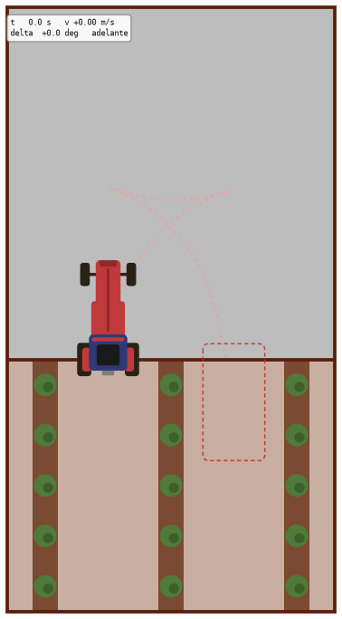
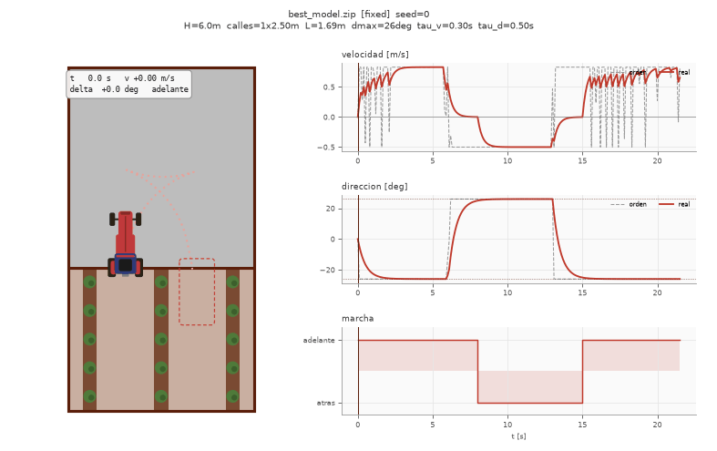
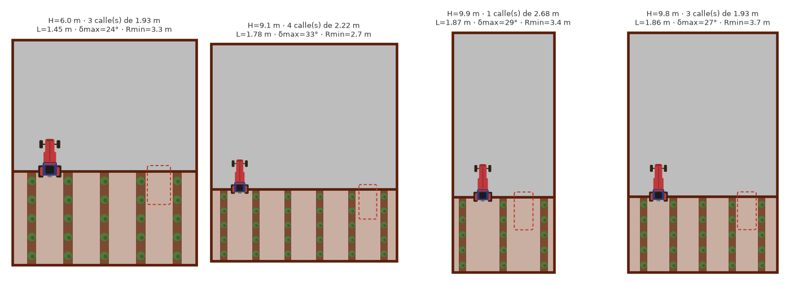

# HeadlandRL

**Aprendizaje por refuerzo para el cambio de calle (_headland turn_) de un vehículo agrícola en viñedo**, con aleatorización de dominio geométrica y dinámica y una extensión de adaptación en línea.

Trabajo de Fin de Máster. El vehículo de referencia es el Renault Twizy automatizado por el Centro de Automática y Robótica (CSIC-UPM) para inspeccionar viñedos.

<p align="center">
  
</p>

<p align="center"><sub>Política PPO del paso A: sale de la calle, maniobra en la cabecera en tres tramos (adelante, atrás, adelante) y entra en la calle siguiente. Línea continua, hacia delante; discontinua, marcha atrás. Reproducido a doble velocidad.</sub></p>

---

## El problema

Al final de cada hilera, el vehículo tiene que salir de la calle, maniobrar en la cabecera y entrar en la siguiente sin tocar las cepas. La solución clásica (curvas de Dubins y Pure Pursuit) supone un modelo del vehículo que puede no coincidir con el real. Una política aprendida por RL puede adaptarse mejor, pero corre el riesgo de no generalizar a viñedos o vehículos distintos de los que vio al entrenar.

El estudio mide de forma sistemática **cómo afecta la aleatorización de la geometría del cultivo y de la dinámica del vehículo a esa generalización**, y si una política que **infiere el dominio a partir de su historial** recupera parte de lo que se pierde al no conocerlo.

## Resultado actual: paso A

<p align="center">
  
</p>

| Métrica | Valor |
|---|---|
| Tasa de éxito, acciones deterministas | **20/20** |
| Tasa de éxito, acciones estocásticas | **50/50** |
| Error final de posición / orientación | 0,27 m / 3,1° (tolerancia 0,30 m / 10°) |
| Duración y recorrido | 21,5 s, 11,2 m |
| Cambios de marcha | 2 (maniobra de tres tramos) |
| Entrenamiento | PPO, 3 M pasos, ~15 min en CPU con 8 procesos |

Escenario nominal: Twizy con batalla de 1,69 m y dirección máxima de 26° (radio mínimo de 3,47 m), cabecera de 6 m y calle de destino adyacente a 2,5 m. Con la huella real del vehículo **no existe maniobra solo hacia delante**, así que la política tiene que usar la marcha atrás.

> El paso A es la **referencia inferior** del estudio: la política solo ha visto este escenario. Falta evaluarla en los regímenes fuera de distribución, que es lo que la convierte en referencia.

## Cómo funciona

### Modelo del vehículo

Modelo bicicleta con actuación de primer orden, como en la propuesta:

$$
\dot{x} = v\cos\theta,\quad \dot{y} = v\sin\theta,\quad \dot{\theta} = \frac{v}{L}\tan\delta,\quad
\dot{v} = \frac{v_{cmd}-v}{\tau_v},\quad \dot{\delta} = \frac{\delta_{cmd}-\delta}{\tau_\delta}
$$

Ajustes al vehículo real (Bengochea-Guevara et al., 2025):

- **Velocidad** de hasta 0,83 m/s (3 km/h, la de operación en viñedo) y marcha atrás de hasta 0,5 m/s.
- **Huella** rectangular de 2,32 × 1,23 m: las colisiones se comprueban con todo el vehículo, no con un punto.
- **Cambio de marcha**: para invertir el sentido el vehículo frena hasta parar y espera 1 s, porque en el Twizy la marcha se cambia por CAN emulando los botones.

La política actúa a 10 Hz. Observa la pose, la velocidad, la dirección, el error respecto al objetivo y la marcha engranada, y decide la orden de velocidad y de dirección.

### Condiciones experimentales

<p align="center">
  
</p>

<p align="center"><sub>Escenarios de la condición D: cambian la cabecera, la separación y la distancia a la calle de destino, y la batalla y la dirección máxima del vehículo.</sub></p>

| Paso | Durante el entrenamiento varía… | Papel | Estado |
|---|---|---|---|
| **A** | Nada (escenario nominal) | Referencia inferior | ✅ entrena; falta la evaluación OOD |
| **B** | Geometría del cultivo | Aísla la incertidumbre geométrica | ⏳ |
| **C** | Dinámica del vehículo (L, δmax, τv, τδ) | Aísla la incertidumbre dinámica | ⏳ |
| **D** | Ambas | Condición realista; análisis de interacción | ⏳ |
| **E** | Ambas, y la política recibe los parámetros reales | Oráculo (referencia superior) | ⏳ |
| **F** | Ambas, y la política los infiere del historial | Adaptación en línea (extensión) | ⏳ |

Todas se compararán con un método clásico sin aprendizaje en cinco regímenes de evaluación: dentro de distribución, fuera de distribución en geometría, en dinámica y en ambas, y frontera de factibilidad.

### Cómo aprende la maniobra

Explorando al azar, el vehículo choca siempre y nunca descubre una maniobra de tres tramos con cambios de marcha. Lo que la hace aprendible:

1. **Referencia experta.** Un planificador Hybrid A* con la huella real calcula una maniobra válida (`scripts/plan_reference.py`).
2. **Backplay con currículo adaptativo.** Al principio el vehículo aparece cerca del final de la referencia, y el punto de aparición retrocede **solo cuando la política acierta desde ahí el 60 % de las veces**. Con un ritmo fijo, el tramo marcha atrás pasaba sin aprenderse.
3. **Condiciones reales desde el primer paso.** La velocidad, la tolerancia de llegada y el tiempo de cambio de marcha no se suavizan durante el entrenamiento. Cuando se suavizaban, la política aprendía unas condiciones que no eran las de la evaluación.
4. **Recompensa de progreso a lo largo de la referencia.** La distancia euclídea al objetivo castiga el tramo marcha atrás, que aleja. El avance solo cuenta en el sentido de marcha del tramo, y cada cambio de marcha se penaliza, para que oscilar adelante y atrás no sea rentable.
5. **Exploración compatible con el cambio de marcha.** Acciones normalizadas, ruido inicial pequeño y correlacionado en el tiempo (gSDE). Con el ruido por defecto, la orden cambiaba de signo casi en cada paso y la política acababa parada.

## Uso

Requiere [uv](https://docs.astral.sh/uv/). **No pongas el proyecto en OneDrive**: el antivirus en la nube de la universidad pone en cuarentena archivos de paquetes dentro de `.venv`.

```bash
uv sync --group dev --group train
uv run pytest tests/ -q
```

Paso A:

```bash
uv run python scripts/plan_reference.py      # solo si falta data/references/reference_A.npy (~1 min)
uv run python scripts/train.py --config configs/train_A.yaml --seed 0
uv run python scripts/evaluate.py --model runs/A/seed_0/best_model.zip --episodes 20
```

Visualización:

```bash
uv run python scripts/visualize_policy.py --model runs/A/seed_0/best_model.zip          # GIF junto al modelo
uv run python scripts/visualize_policy.py --model runs/A/seed_0/best_model.zip --show   # ventana en vivo
uv run python scripts/visualize_policy.py --model random --dr-mode joint --episodes 3   # política aleatoria
```

Opciones útiles: `--scene-only` (solo la escena), `--every 2 --speed 2` (más ligero y rápido), `--out demo.mp4` (requiere ffmpeg).

## Estructura

```
configs/
  env_default.yaml         # rangos de la propuesta y decisiones de implementación
  train_A.yaml             # paso A: PPO, currículo, recompensa
data/references/           # referencias expertas para el backplay
docs/media/                # GIF e imágenes de este README
src/headland_rl/
  config.py                # build_env(cfg): el mismo entorno en entrenamiento, evaluación y visualización
  viz.py                   # dibujo vectorial de la escena y del vehículo
  envs/
    headland_env.py        # HeadlandTurnEnv (Gymnasium): dinámica, recompensa, currículo
    wrappers.py            # acciones normalizadas a [-1, 1]
    params.py              # VehicleParams / CropParams / DomainRanges
    randomization.py       # modos de aleatorización A-D y regímenes de evaluación
    geometry.py            # poses, colisiones con la huella, factibilidad
    dubins.py              # caminos de Dubins
  classical/pure_pursuit.py  # método clásico Dubins + Pure Pursuit
scripts/
  train.py                 # PPO (SB3) con currículo adaptativo y SubprocVecEnv
  evaluate.py              # métricas principales -> CSV + JSON
  plan_reference.py        # Hybrid A* con la huella del vehículo
  visualize_policy.py      # animación (GIF/MP4/ventana)
  diag/                    # sondas y comprobaciones puntuales
tests/
report/                    # propuesta del TFM (local, no versionado)
runs/                      # salidas de entrenamiento (no versionado)
```

## Hoja de ruta

- [x] Entorno parametrizable con los modos A–D y la observación privilegiada E
- [x] Simulador ajustado al Twizy: velocidad, huella y cambio de marcha
- [x] Paso A: PPO resuelve el escenario nominal
- [ ] Evaluación por regímenes (ID, OOD geométrico, dinámico y conjunto, frontera de factibilidad)
- [ ] Referencia de backplay para cada episodio (Hybrid A* o Reeds–Shepp), necesaria para B–F
- [ ] Método clásico con marcha atrás (planificador + seguidor); el actual solo avanza
- [ ] Pasos B–E con varias semillas y pruebas estadísticas
- [ ] Paso F: política con memoria y codificador estilo RMA
- [ ] Conducción más suave (ahora la dirección va al tope y la velocidad a tirones) y despliegue en el Twizy (ROS + ONNX)

## Decisiones de implementación

No están en la propuesta y están marcadas en el código:

- `v_rev_max = 0,5 m/s`, `gear_switch_time = 1 s`, voladizos de 0,315 m delante y detrás.
- `row_width = 0,5 m`, `crop_depth = 5 m` y márgenes de la zona válida.
- Ruido en la pose inicial `(0,15 m, 0,15 m, 5°)`, solo cuando se aleatoriza la geometría.
- Paso A: `dt = 0,1 s`, `max_steps = 500` (50 s) y tolerancias de éxito de 0,30 m y 10°. Los valores por defecto del entorno son `dt = 0,05 s` y `max_steps = 1000`.
- Espacio de acción fijo, recortado a los límites de cada episodio para que no cambie con la aleatorización.

**Problema abierto:** con la huella del Twizy, las calles más estrechas del rango de la propuesta (1,8 m) apenas dejan holgura, y ~10 % de los episodios de B y D empiezan ya en colisión. Hay que decidir si subir el mínimo, aleatorizar también la anchura del vehículo o descartar los episodios inviables.

## Referencias

- Bengochea-Guevara, J. M. et al. *Drive-by-wire automation and field validation of a commercial electric vehicle for autonomous crop monitoring*. Smart Agricultural Technology 12 (2025) 101530.
- Pindl, L. et al. *Reinforcement Learning for Autonomous Headland Turns*. ICINCO 2024.
- Salimans, T. y Chen, R. *Learning Montezuma's Revenge from a Single Demonstration*. 2018 (backplay).
- Kumar, A. et al. *RMA: Rapid Motor Adaptation for Legged Robots*. RSS 2021.
- Stable-Baselines3: https://stable-baselines3.readthedocs.io
